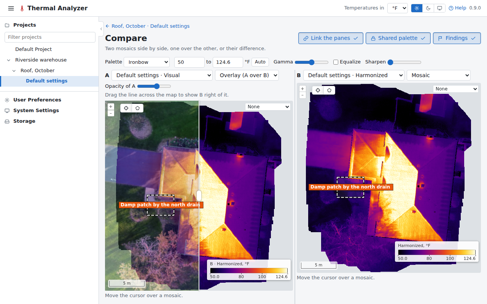

# Compare

The compare page shows two datasets side by side, one over the other, or their difference, from any flight, the
project's listed first. Open it with **Compare with…** in the viewer's header or on a dataset's card.

- **A pane** shows a dataset's mosaic, or its visual mosaic.
- **Overlay (A over B)** draws pane A's mosaic over pane B's in one pane, faded with an opacity slider and cut at a
  swipe line dragged across it: visual over thermal, or two thermal mosaics.
- **The difference** of two mosaics, in one pane.

The header's **Link the panes**, **Shared palette** and **Findings** stay pressed in, with a check, while they are on.

Each pane draws its flights' [findings](findings.md#on-the-compare-page), and a spot or an area drawn with the tools
on a pane's map is [measured](measuring.md) there, opens its [source frames](measuring.md#source-frames), or is kept
as a finding.
