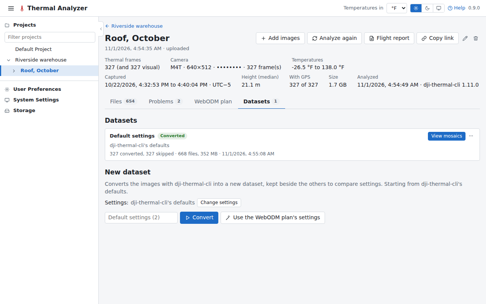

# Datasets

A dataset is a flight's images converted to temperatures with dji-thermal-cli's settings, with its mosaics. They are
on the flight page's **Datasets** tab, where the page opens once there is one.

## Converting

The tab lists the flight's datasets first, then the **New dataset** bar: the settings summed up and the **Convert**
button. **Change settings** shows them all, each output named for what it is for, with dji-thermal-cli's name beside
it. A [problem](flights.md#problems) a setting fixes opens this form with that setting already changed.

A dataset left unnamed is named after the settings that change its temperatures or mosaics ("Emissivity 0.9 ·
normalized", else "Default settings"), as the name field shows before converting.

You can keep several datasets side by side, cancel one while it converts, or download it.

## The outputs

- **Temperatures** as TIFFs, which [WebODM](webodm.md) can process.
- **The mosaics**, opened in the [viewer](mosaics.md).
- **The visual mosaic:** when a flight has visual images, a dataset builds their mosaic with the thermal ones ("And the
  visual mosaic", on by default), at the visual camera's own resolution. dji-thermal-cli places each visual image
  where its thermal frame is in the thermal mosaic, after measuring and correcting the small angle between the two
  cameras, so the two mosaics line up. Zoom camera images are left out. It is in the downloads beside the thermal
  mosaics.
- **R-JPEG** (`rjpeg`) writes each frame again as an R-JPEG with the dataset's measurement parameters in DJI's header,
  so DJI's own tools measure it as this app does. Its picture, what photo viewers show, is coloured with the dataset's
  palette or kept as DJI's.

## A flight of visual images only

A flight with visual images and no thermal ones has nothing to convert: each of its datasets is the mosaic of its
visual images, which dji-thermal-cli lays out by their own overlaps (matching them to each other, estimating the
camera's lens distortion and the surface's heights), at the camera's full resolution. On the 327-photo test flight it
took about 7 minutes. The New dataset form says so, its button is **Make mosaic**, and **Change settings** shows only
what applies:

- **Only frames with a gimbal pitch at or below (°)**: -80 keeps the nadir frames only.
- **Pixel size (cm)**: empty for the frames' own.
- **Height cells (px)**: empty for 32, in the pixels the frames are aligned at. Smaller cells follow steps in the
  surface, such as a roof's edge, more closely, and take longer.
- **Remove the location from the files.**

An unnamed one is named "Visual mosaic", followed by whichever of these settings are changed. Its card says
**Ready** and **View mosaic**, and its files are the mosaic, its sidecar and its preview. It has no temperatures:

- In the [viewer](mosaics.md), a spot opens the frames that saw it, and a line or an area is
  [measured](measuring.md#on-a-visual-mosaic) for its length, or its area and perimeter, saved as a measurement or
  kept as a [finding](findings.md).
- Its [frames](frames.md#the-photos-of-a-flight-of-visual-images-only) are the flight's photos, shown as they were
  taken.
- On the [compare page](compare.md) it can be shown beside any mosaic, or over one.
- Its [mosaic report](reports.md#mosaic-report) shows the mosaic with its measurements and findings.

It has no WebODM processing, and the flight's WebODM plan tab says there is nothing to plan.

## Importing from WebODM

**Import from WebODM**, beside **Convert**, brings an orthophoto made in WebODM into the flight as a dataset of its
own. Nothing is converted: the dataset is the orthophoto (and its surface model).

- **From WebODM** browses the projects of the app's [WebODM account](webodm.md#connecting-it), newest first, with
  a search. A project's completed tasks with an orthophoto are cards, each with a preview of the orthophoto, its name,
  when it was made, and **Orthophoto** and **DSM** chips; those whose orthophoto lies over the flight's photos are
  marked **Over this flight** and come first. The project says how many tasks it has besides (still running, failed,
  or without an orthophoto). The chosen task is shown larger beside them, with its project, date, number of images
  and how long WebODM took, and **Its DSM too** when it has one (ticked at first).
- **From a file** takes the orthophoto's GeoTIFF from a task's **Download assets** on WebODM's page, and its DSM if
  you have it (up to 1 GB each). The task's cameras, its **Camera Shots** (`shots.geojson`) and **Camera Parameters**
  (`cameras.json`) from the same menu, are optional, both or neither: they find the flight's photos that saw a spot.

The dataset is named after the task or the file unless named in the dialog. Its card follows the download and the
reading (**Importing**, with **Cancel**), then says **Imported**, where it came from and what it holds:

- **Temperatures**: an orthophoto of one band of values, read as °C as ODM writes them and shown in your unit, is the
  viewer's **WebODM** tab, as a [task's orthophoto brought back](webodm.md#bringing-the-results-here) is. Its preview
  is coloured with your palette.
- **Colours**: an orthophoto of red, green and blue is the dataset's visual mosaic, as a
  [flight of visual images only](#a-flight-of-visual-images-only) has.
- **DSM**: its surface model, the viewer's **Heights** tab.

An orthophoto of anything else (several bands of values, or none georeferenced) isn't imported, and its card says
why. One imported from a task has **Open in WebODM**, the task in WebODM's dashboard. **View mosaics** opens it in the
[viewer](mosaics.md#an-imported-dataset). An imported dataset has no settings, frames page or WebODM tasks of its own:
its menu has **Download all**, **Rename** and **Delete**. One imported from a task brings the task's cameras along,
for the [frames that saw a spot](mosaics.md#the-frames-of-a-spot).

## A dataset's card

Each dataset on the tab has a card with its settings and progress. Its button is **View mosaics** once the mosaics
are built (else **Frames**, or **Cancel** while it converts), and its menu (**More**) has:

- **Frames**, the [frames explorer](frames.md), and **Compare with…**, the [compare page](compare.md).
- **Download all**, the dataset's files as a zip, made as it downloads.
- **Files**, its files listed on the card, each opening its frame.
- **Use settings**, its settings put back in the New dataset form.
- **Build mosaics**, when they were not built with it.
- **Process in WebODM** (see [WebODM](webodm.md)).
- **Rename** and **Delete**. Deleting a dataset deletes its measurements too, and a
  [Delta T across it and another dataset](measuring.md#a-delta-t-across-the-two-images) from that one as well: the
  dialog names them first.
