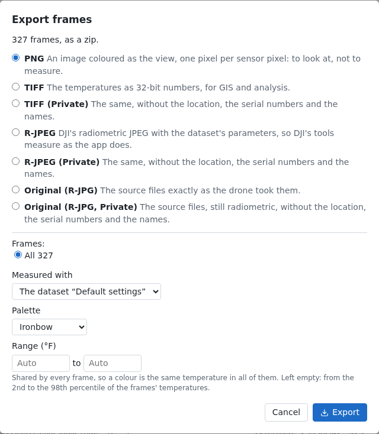

# Exports

**Export…** opens the Export dialog:

- on the [frame page](frames.md), for the frame shown, as converted or with the parameters changed;
- on the flight page's [Files tab](flights.md#files), for the frames the filter shows or all of them, measured with
  one of the flight's datasets or the frames' own values, with a palette and one range shared by all of them;
- on the [viewer](mosaics.md), for the mosaic tab shown.

## The formats

A frame, the frames chosen or a whole flight export as:

- **Original:** the files as they are.
- **TIFF:** the temperatures.
- **PNG:** coloured as the view, one pixel per sensor pixel.
- **R-JPEG:** DJI's format, with the measurement parameters in its header.

A mosaic exports as its **GeoTIFF**, or a **PNG** of the view at full size.

Each format says what it is for. R-JPEG and Original are turned off, with the reason, for a normalized dataset or
replaced values, which only TIFF carries.

## Private

Each format can also be **Private**: without the location, the serial numbers and the free-text fields where a name
or an email address could be. A private mosaic's GeoTIFF has no place.

## Downloads

Several files come as a zip, made as it downloads. **Export PNG**, in the viewer, still saves the view as shown.
