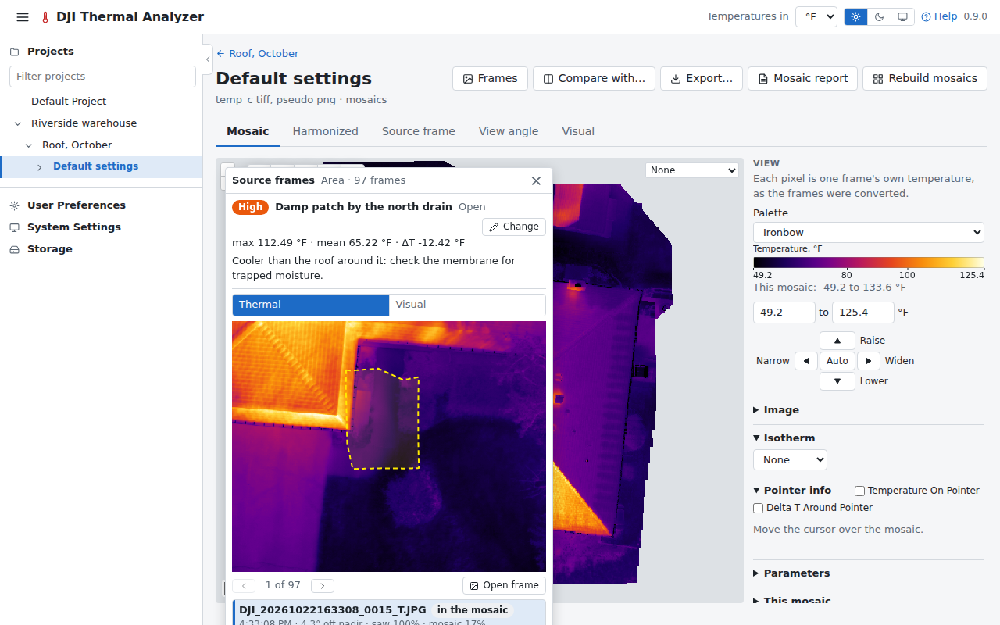

# Findings

A finding is a spot or an area of a mosaic kept on its flight, with a name, notes, a severity and a status, the
temperatures measured when it was kept, and the frames that saw it (all of them, or those you pick). On the visual
mosaic of a [flight of visual images only](datasets.md#a-flight-of-visual-images-only), an area's finding keeps its
area and perimeter instead, and its frames are the visual photos. A finding on an
[imported dataset](mosaics.md#an-imported-dataset) keeps no frames: ODM doesn't record which photos its orthophoto
was made of.

## Keeping one

- Draw a spot or an area on a mosaic and press **Keep as finding** on its card: the form opens with the frames beside
  it.
- Or keep one from the [source frames](measuring.md#source-frames) window, or from a saved spot or area measurement.

## On the viewer

The viewer draws the findings on the map, outlined and tagged in their severity's colour. Click one, or its line in
the side panel's Findings list, to open it with its frames and change it. They can all be hidden with
one switch, or one by one, and a link keeps which are shown and which is open.

## On the compare page

On the [compare page](compare.md) each pane draws its flights' findings, opened with a click or a link and changed
there. A spot or an area drawn in a pane is kept on the flight of its mosaic (for a difference, the mosaic picked in
the window).

## Elsewhere

A project's page lists its flights' findings together. The [reports](reports.md) list them with thumbnails of their
kept frames, numbered on their maps. A [saved video frame](flights.md#saved-frames) can be attached to a finding.
