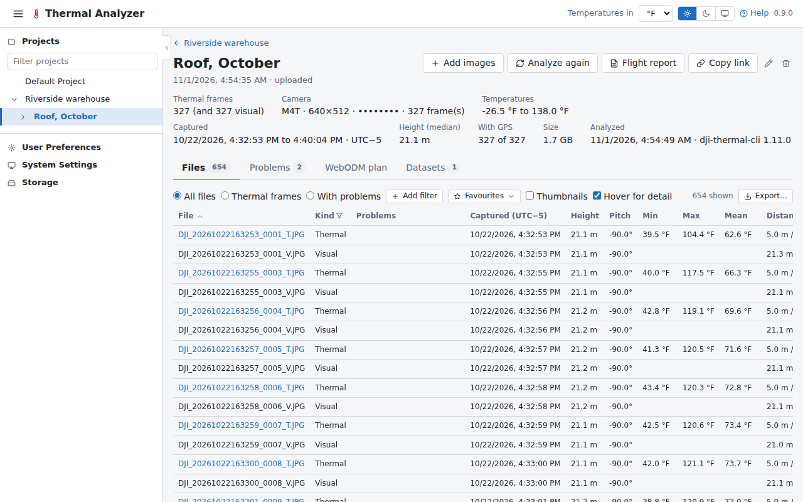

# Flights

A flight holds the images of one flight of the drone. Its page has the flight's figures and its tabs: **Files**,
**Videos**, **Problems**, **WebODM plan** and **Datasets**.

## Making a flight

**New Flight** on a project's page names the flight and takes its images, chosen one by one (**Choose images**) or
as a folder (**Choose a folder**), with their thumbnails. The images can also be dropped on the project's page.
**Add images** on the flight's page adds more later.

- **Thermal images:** DJI R-JPEGs.
- **Visual images** the drone takes with them (DJI's `_V` or `_W`, as on the Matrice 4T or the H20T/H30T). The Files
  tab calls them visual and shows what their metadata records (time, position, height, gimbal pitch and yaw, the
  rangefinder's distance), with no temperatures or measurement settings.
- **Videos:** the drone's MP4s (see [Videos](#videos)).

Other files, such as TIFFs (a converted dataset's temperatures among them), cannot make a flight and are left out. A
flight made in place from a folder by an earlier version still reads its images there.

## The analysis

Once the images are in, dji-thermal-cli analyzes the flight: its files, cameras and the problems it finds. While it
runs the page shows its progress; after it, a flight with no dataset yet says so above its tabs, with the way to
[convert](datasets.md) it.

## Problems

The Problems tab lists each problem dji-thermal-cli finds, in the New dataset form's words, its temperatures in the
unit chosen under User Preferences, and its files listed with their values (each opening the Files tab on it). The
problem's code is the badge's tooltip.

A problem a setting fixes has a button that opens the Datasets tab with that setting changed in the New dataset form,
converting nothing: normalizing the frames, one emissivity or humidity, the embedded or one fixed distance, or the
oblique frames included when too few nadir frames are left.

## Files

The Files tab lists a flight's files, sorted by any column.

- **Filtering:** conditions on any column (Height ≤ 21, Min > 32 °F, Kind is one of Thermal…), every one of which a
  file shown matches: numbers in the unit shown, text by its words. The Kind column's checkboxes and the Problems
  column (yes or no) filter too. **All files**, **Thermal frames** and **With problems** set the filter they stand
  for, to change from there.
- **Problems column:** names each problem a file is in (Unusual max, Oblique…), with its sentence as the tooltip, and
  why a file isn't used.
- **Favourites:** the filter is kept in the page's link, and can be saved under a name as a favourite, offered on
  every flight's Files tab. A favourite is deleted, never overwritten.
- **Hover for detail** (checked by default, remembered by the browser): a pane at the right shows a file's picture,
  larger (a video's cover), and its columns as the pointer passes over its thumbnail or name. Clicking a row keeps it
  there until it is clicked again or closed (×, or Escape); unchecked, only a clicked row opens the pane.
- **Full size**, in the pane, shows the picture at its own size over the page: fitting the window at first, zoomed
  with the wheel or shown 1:1, and moved by dragging. Escape or × closes it.

The tab's thermal pictures (thumbnails, pane and full size) are coloured with the palette chosen under User
Preferences, over each frame's own range; with "As each flight's images" they are the camera's own pictures.
**Export…** exports the frames the filter shows, or all of them (see [Exports](exports.md)).

## Videos

The Videos tab lists a flight's videos with their covers, length, start time and drone. The one chosen plays beside
a map of its track, with a marker on the frame shown, and a click on the track goes to that moment. Under it are the
frame's time and number, height above take-off, gimbal pitch and yaw, heading, speed and position.

DJI's newer drones (the Matrice 4T among them) write no SRT: the track is read from the metadata DJI puts in the MP4,
a point per frame, with nothing more installed, and the browser plays the video. A video's picture has the palette
already applied, with a range that changes from frame to frame: it holds no temperatures.

### Playback

A frame or a second back or on, ⅛× to 2×, and a loop between an in and an out point at any speed.

| Key | |
|---|---|
| ++space++ | play and pause |
| ++arrow-left++ ++arrow-right++ | a frame back or on (with ++shift++, a second) |
| ++i++ ++o++ | set the in and out points |
| ++l++ | turn the loop on and off |
| ++minus++ ++plus++ | change the speed |
| ++s++ | save the frame shown |

### Recoloured

The frame shown can be turned back into the camera's levels (0 to 255) through DJI's Ironbow, then drawn in any
palette, with a range (Auto takes the frame's 2nd to 98th percentile, its cross's arrows step it within
the frame's levels as on a [mosaic](mosaics.md#the-side-panel), and the range stays put from frame to frame),
brightness, contrast, gamma, sharpening and an isotherm in levels. It starts as filmed (DJI ironred, 0 to 255). The
pointer gives the level and pixel under it.

Levels are relative: the camera re-ranges each frame, so a level is not the same heat from one frame to the next. The
Ironbow table is the Matrice 4T's.

### Saved frames

**Save frame** (or ++s++) keeps the frame shown, as shown (recoloured or as filmed), with its time, the drone's
position, height and gimbal, and how it was coloured. They are listed under the video: a click on one goes back to
that frame as it was shown. Each has a name, notes and a [finding](findings.md) it can be attached to, and can be
deleted. The flight report shows them, numbered V1, V2… on its map, and a finding's reports show those attached to
it. A project's export carries them.

## WebODM plan

The WebODM plan tab says how the flight would be processed in WebODM: its coverage, the task options recommended
and those to consider, and how to prepare the images. See [WebODM](webodm.md).

## Deleting

Deleting a flight deletes only what the app made: a flight read in place from a folder leaves its images there.
