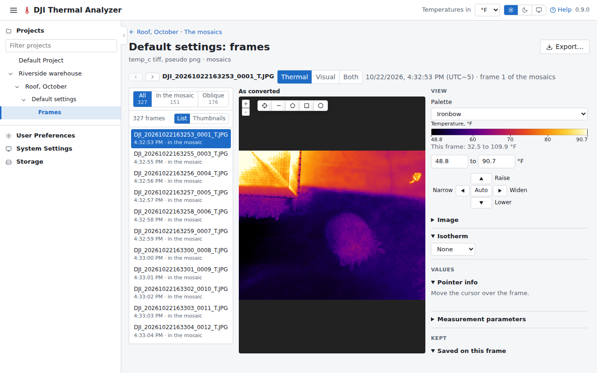

# Frames explorer

The frame page shows a dataset's frames one at a time, as converted, opened with **Frames** on its card, in the
viewer's header or under the dataset in the navigation pane.

## The list

The frames are listed beside the frame shown, in the order they were taken. Once the mosaics are built, a switch
shows all of them, those **In the mosaic** (the frames the mosaic placed) or the **Oblique** ones (those it left out
for their angle, whose angles show what a view straight down misses, including those a conversion with a pitch limit
did not convert), with their counts. The switch is kept in the page's address.

They are listed as a list (name, time, and whether a frame is in the mosaic, oblique at its angle, left out as
unusable or not converted) or as thumbnails, a switch the browser remembers.

The first is shown on opening; a click or ++arrow-left++ ++arrow-right++ shows another.

## The frame

The frame has the viewer's palette, range (with its cross of Narrow, Widen, Lower and Raise round Auto, within the frame's own
temperatures), image sliders, Pointer info and [measuring](measuring.md). Its **Thermal**/**Visual**/**Both** switch
shows the frame's visual image in its place or beside it, with the same shapes and the cursor on it, and measures the
thermal frame under them. A frame can be measured again with other parameters.

## The map

Its small map shows where the frames were taken. It can show the flight's visual photos too (orange squares), a
switch the browser remembers.

**Export…** exports the frame as shown, with its saved measurements and colour scale, or the frame alone, as converted
or with the parameters changed (see [Exports](exports.md)).
