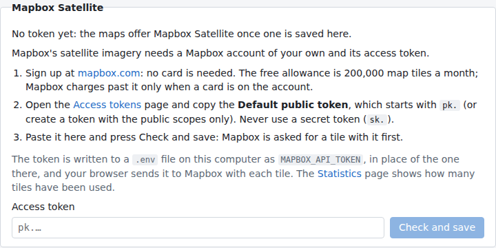

# The maps under the mosaics

The switch at the top right of a mosaic's map chooses what is under it. Every map starts with the one chosen under
User Preferences › Map (ESRI Satellite unless another is chosen), and switching changes that map only.

- **ESRI Satellite** (the default) and **OpenStreetMap** need nothing set up. Where Esri's imagery stops short of the
  zoom shown, its deepest level there is stretched instead of showing "Map data not yet available".
- **Mapbox Satellite** needs a Mapbox account of your own and its access token, saved under System Settings. The
  switch lists it once a token is known.
- **None** shows the mosaic alone, and loads nothing from the internet.

## Mapbox Satellite

### Getting the token

1. Sign up at [mapbox.com](https://account.mapbox.com/auth/signup/): no card is needed. The imagery comes through
   Mapbox's Static Tiles API, whose free allowance is 200,000 tiles a month; Mapbox charges past it only when a card
   is on the account.
2. On the [Access tokens](https://console.mapbox.com/account/access-tokens/) page, copy the **Default public token**
   (it starts with `pk.`), or create a token with the public scopes only. A secret token (`sk.`) is refused: the
   browser sends the token to Mapbox with each tile, so anyone using the page could read it. Mapbox's URL
   restrictions do not accept `127.0.0.1`, so leave the token unrestricted.
3. Paste it under System Settings › Mapbox Satellite and press **Check and save**. Mapbox's
   [Statistics](https://console.mapbox.com/account/statistics/) page shows how many tiles have been used.

The app first asks Mapbox for one tile with the token, and saves it only if Mapbox serves it. Otherwise it says why
(a wrong token, the account's limit, or Mapbox out of reach), and nothing is changed.

### Where it is kept

The token is kept as `MAPBOX_API_TOKEN` in a `.env` file: the one in the folder the app is started from or in the
data folder, whichever it was read from (else the data folder's, made readable by you only). A new token replaces the
old one in that file, the file's other lines kept; no earlier token is kept, and a token can be replaced but not
removed there.

You can also write `MAPBOX_API_TOKEN=pk....` in one of those files yourself. A `MAPBOX_API_TOKEN` in the environment
the app is started from wins over the files: System Settings then shows it, and it is changed there. A token saved by
an earlier version of the app (in its preferences) is moved to the data folder's `.env` when the app starts, unless a
token is already known.
