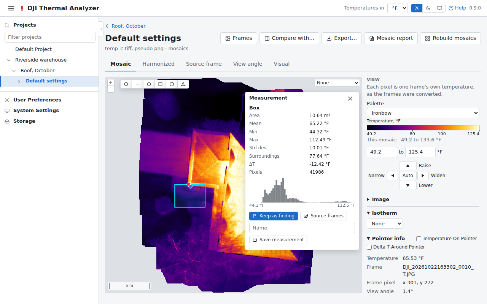

# Measuring

Spots, lines, areas, boxes and circles are measured on mosaics, in the [viewer](mosaics.md) and on the
[compare page](compare.md), and on single frames, on the [frame page](frames.md).

## Drawing a shape

The drawing tools are on the map's top edge, beside the zoom buttons. A shape drawn is measured in a card on the map,
closed with × or Escape. The card gives the temperature at a spot, or a shape's mean, min, max and standard
deviation, its surroundings and the ΔT against them, the share inside the isotherm, its pixels, and a line's profile
or an area's histogram.

On the card:

- **Save measurement** keeps it, listed in the side panel's Saved measurements.
- **Keep as finding**, for a spot or an area of a mosaic: see [Findings](findings.md).
- **Source frames**, for a spot or an area of a mosaic: see below.

On a frame page, the Thermal/Visual/Both switch shows the frame's visual image in its place or beside it, with the
same shapes and the cursor on it, and measures the thermal frame under them.

## On a visual mosaic

The dataset of a [flight of visual images only](datasets.md#a-flight-of-visual-images-only) has no temperatures. In
its viewer, the card of a line gives its length, and that of an area, box or circle its area and perimeter, in
metres on the mosaic. They are measured on the mosaic, so they are only as exact as it is (see
[Mosaics](mosaics.md)). The card has **Save measurement**, **Keep as finding** and **Source frames**, as on a thermal
mosaic, and its saved measurements export as CSV and GeoJSON with their length, area and perimeter. A spot opens the
frames that saw it.

## Saved measurements

Saved measurements can be compared, measured again with other settings, and exported as CSV and GeoJSON. Each can
have a comment, shown in the viewer's list, in the CSV and GeoJSON, and in the
[mosaic report](reports.md#mosaic-report).

## Source frames

The source frames window shows every frame that saw a spot or an area of a mosaic, the one the mosaic used first,
each with its time and view angle and the spot marked or the area outlined in it, in the thermal frame or, with the
Thermal/Visual switch, its visual image.

It opens from:

- **Source frames** on a measurement's card;
- a spot or an area drawn (or a click) on the Source frame or Visual tab;
- a saved measurement's;
- on the compare page, a spot or an area drawn with the tools on a pane's map.

A [finding](findings.md) can be kept from it. Mosaics built before version 0.5.0 list only the frames they used:
build them again to list every frame.
