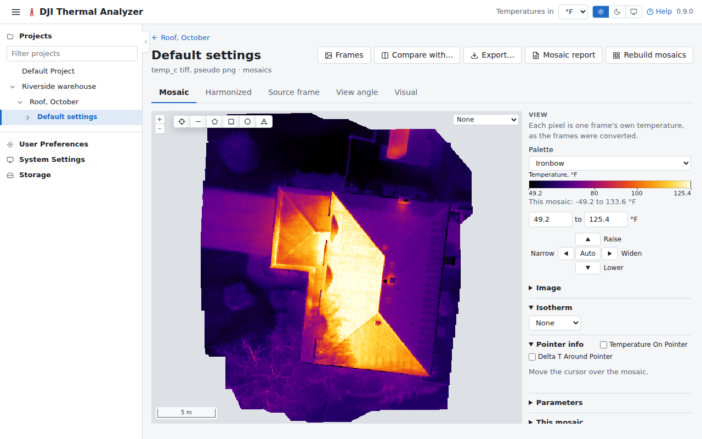

# Mosaics

The viewer shows a dataset's mosaics, opened with **View mosaics** on its card or from the navigation pane.

!!! note "A preview, not an orthomosaic"
    The mosaics are a quick preview to help the analysis: each frame is placed by its own position and the camera's
    angles. They are no replacement for an orthomosaic
    made by photogrammetry, such as [WebODM](webodm.md)'s (ODM's), which matches the frames to each other and models
    the ground from them. Measure distances and areas, and place things on a map, from such an orthomosaic when they
    must be exact.

## The tabs

Each tab's tooltip says what it shows.

- **Mosaic:** each pixel is one frame's own temperature, as the frames were converted.
- **Harmonized:** normalized, with one ambient and reflected temperature for every frame, and each frame's offset
  against its neighbours removed (the camera's drift between recalibrations), so the seams don't show as bands.
- **Source frame:** which frame each pixel comes from (the one that saw it closest to straight down), with a line
  along each seam between the frames (in the mosaic report too).
- **View angle:** how far from straight down each pixel was seen, in degrees.
- **Visual:** the [visual mosaic](datasets.md#the-outputs), when the dataset has one: the visual camera's images, each
  placed where its thermal frame is. Pointer info gives the Mosaic tab's temperatures, and a click opens the frames
  that saw the spot.
- **WebODM** and **Heights:** an orthophoto and a surface model brought back from
  [WebODM](webodm.md#bringing-the-results-here).

The dataset of a [flight of visual images only](datasets.md#a-flight-of-visual-images-only) has the Visual tab alone,
with no palette or temperatures. A click on a spot, or a spot drawn, opens the visual frames that saw it, each shown as
it was taken with the spot marked, the one the mosaic took it from first (the frame that saw it closest to straight
down). A line, area, box or circle drawn is [measured](measuring.md#on-a-visual-mosaic) for its size. The side panel
lists the saved measurements and the flight's findings, and **The mosaic** says how it was laid out: the frames used,
the camera's boresight and lens distortion, the surface's heights and how closely overlapping frames agree. Its header
has **Compare with…**, **Mosaic report** and **Rebuild mosaic**.

## An imported dataset

A dataset [imported from WebODM](datasets.md#importing-from-webodm) is shown as it holds:

- **An orthophoto of temperatures** on the **WebODM** tab, with its palette, range, Pointer info, measuring and
  findings as for any mosaic of temperatures.
- **An orthophoto of colours** on the **Visual** tab, as the visual mosaic of a flight of visual images only is: a click
  opens the photos that saw the spot, and a line or an area is measured for its size.
- **Its DSM** on the **Heights** tab, beside either. Beside a Visual tab, Heights loads the page again on the
  temperatures' viewer, and Visual brings it back.

The header has **Open in WebODM** (the task it came from, in WebODM's dashboard, for one imported from a task),
**Compare with…**, **Export…** (on the WebODM and Heights tabs) and **Mosaic report**, with no **Frames** or **Build mosaics**; **The
mosaic** in the side panel says where it came from: the WebODM project and task, when the task was made, from how many
images, how long WebODM took, and the DSM (or the files' names).

### The frames of a spot

ODM doesn't record which photo each pixel of its orthophoto comes from, so the flight's photos that saw a spot or an
area are found from the task's cameras instead: where WebODM placed each photo and how its lens sees, with the spot
at the height of the DSM (or, without one, of the ground under the photos). A click on the WebODM or Visual tab opens
them, as does a measured spot's or area's **Source frames**; the window lists them, the most
nadir first, marked **in the mosaic** as the one most likely used, and a finding keeps them as on any mosaic. A
thermal frame is measured with the settings of the dataset its task was sent from, or with its own parameters for a
task made in WebODM; an orthophoto of colours shows its photos as they were taken. Frames have no **Open frame**: an
imported dataset has no frames page.

- **Imported from a task:** the cameras come with the orthophoto. One imported before they did, or while WebODM
  couldn't give them, fetches them the first time a spot's frames are asked for; while WebODM can't be reached, the
  window says so, and the spot can still be kept as a finding.
- **Imported from a file:** the frames are known only when the task's `shots.geojson` and `cameras.json` came with it.

The photos must be the flight's own: a photo is matched by its name, or by the name of the TIFF it was sent to WebODM
as (`DJI_…_T_temp_c.tiff` for `DJI_…_T.JPG`). Like a mosaic's frames, a photo is listed where it looked towards the
spot, even if something stood in the way.

The viewer opens on Mosaic, or on Harmonized when the frames disagree (their offsets against their neighbours
spanning more than 3 °C over the middle 90% of them), with a notice saying so. A link that names a tab opens that one.

Under the mosaic is a street map or satellite imagery, chosen with the switch at the top right of the map (see
[The maps under the mosaics](maps.md)).

## The side panel

The panel has, from the top:

- **View:** the palette, the temperature range, **Image** (brightness and contrast, gamma, equalization and
  sharpening) and **Isotherm**. They are redrawn as their sliders are dragged. The colour scale is labelled with its
  range's ends, and the line straight under it gives the mosaic's own lowest and highest temperatures.

  Under the range's fields is a cross of buttons. Its centre, **Auto**, sets the range to the mosaic's 2nd to 98th
  percentile. Its arrows step the range: ◀ **Narrow** and ▶ **Widen** take 10% off its span or add 10%, half at each
  end, and ▼ **Lower** and ▲ **Raise** move both ends by 10% of the span (a click on the name does the same). Neither
  end goes past the mosaic's own lowest and highest temperatures: an end that reaches one stays there while the other
  moves on, so the span shrinks. An arrow that would change nothing is greyed out.
- Then **Pointer info** (the values under the cursor), **Parameters** and **This mosaic**.
- Then the saved [measurements](measuring.md) and the [findings](findings.md).
- **About.**

On a first visit Image, Parameters, This mosaic and The mosaic start folded, and each section then stays as it was
left.

## Pointer info

Pointer info gives the values under the cursor. A click keeps them and outlines the frame there, and **Open frame**
then opens that frame on the [frame page](frames.md); Escape or a second click on that frame lets go of it.

**Temperature On Pointer**, in Pointer info's heading, shows the temperature under the cursor in a small tip beside
it, once the cursor rests, and goes on following the cursor while a click keeps Pointer info's values. There is no tip
where Pointer info has no temperature, such as off the mosaic or where it has no data. It is off until ticked, and
then stays ticked in this browser, on the frame page too.

## From the viewer

The viewer's header has **Frames** (the [frames explorer](frames.md)), **Compare with…** (the
[compare page](compare.md)), **Export…** (the mosaic as shown, with its saved measurements and colour scale, or
whole, at full resolution: see [Exports](exports.md)), **Mosaic report** (see [Reports](reports.md#mosaic-report))
and **Rebuild mosaics**.

**Rebuild mosaics** builds the new mosaics beside the last ones, which stay on show until the new ones replace them, so
the disk needs room for both for that time. If the rebuild fails or is canceled, the last ones are kept.
