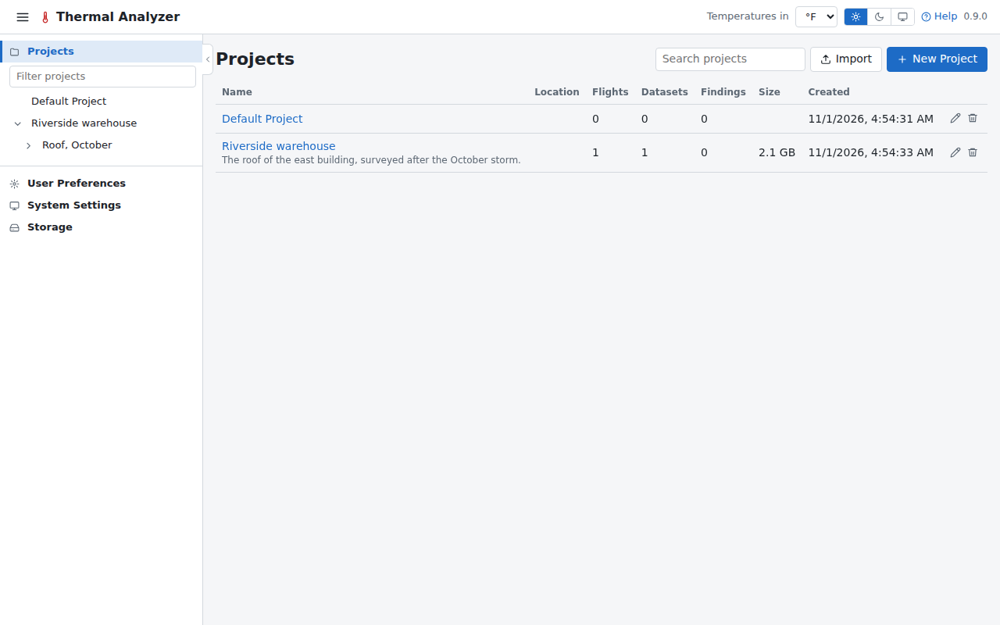
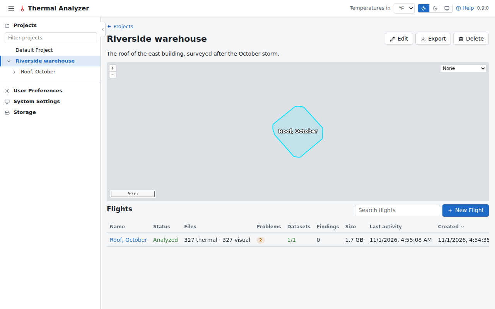

# Projects

A project holds a site's flights together, with a name, a description and a location, and a map of where each
flight was flown. The projects page lists them; a project's page lists its flights, with **New Flight** to add one.

## Making and changing a project

**New Project** on the projects page asks for its name, description and location; the project's own page changes
them later. The flights made before projects existed are in the **Default Project**, which you can rename, and one is
made again whenever none is left. A flight is moved to another project with **Move to another project** in its row's menu on its project's page,
which also has **Rename**, **Analyze again** and **Delete**.

## The location

A project's location is found by searching an address or a place on OpenStreetMap, or by clicking the site on the
map, and keeps the address. The search sends what is typed, or the point clicked, to OpenStreetMap's Nominatim: see
[What needs the internet](../getting-started/first-run.md#what-needs-the-internet).

## Its findings

A project's page lists its flights' [findings](findings.md) together.

## Exporting and importing

A project is exported (backed up) as a `.tar` with all its flights or those chosen: their images (a flight read from
a folder has them copied in), datasets, mosaics, measurements, findings and saved video frames. The export is written
straight to the browser's download, so it needs no room in the data folder.

**Import** on the projects page makes such an archive a new project, here or on another computer. A name already in
use gets a free one ("Roof (2)"), which you can change. Flights that were read from a folder come back as uploaded
ones. An import needs about the archive's size free in the data folder, as it is unpacked there while it is sent.
An archive made on Linux can hold a file another system can't keep: a name with a colon or a question mark on
Windows, or two names that differ only in case on Windows and macOS. The import stops and says which file.

## Deleting

Deleting a project deletes its flights, after saying how many there are and how much space is freed. As with a
flight, only what the app made is deleted: a flight read in place from a folder leaves its images there.
