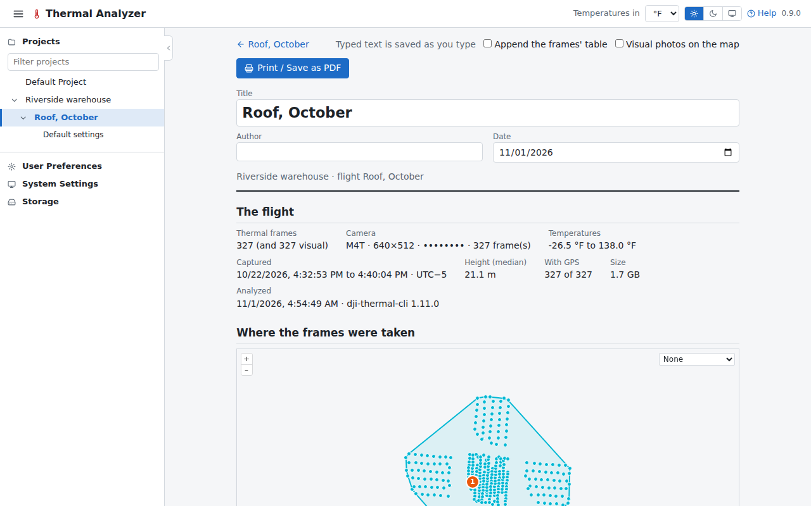
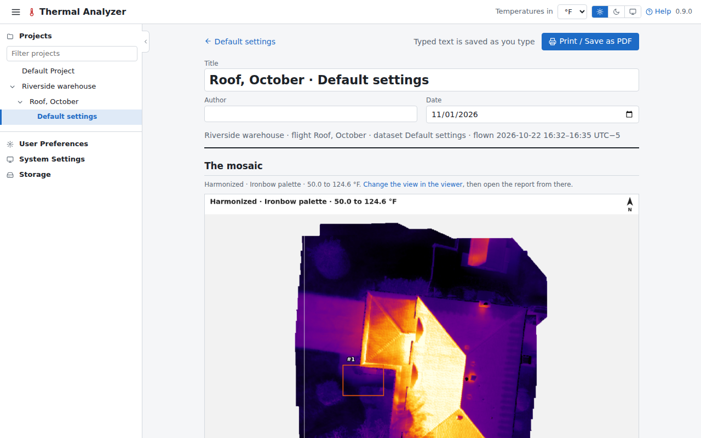

# Reports

The two reports are pages laid out to print, or to save as PDF from the browser's print dialog, on A4 or Letter. They
always print light, without the app's header and controls.

## Flight report

Opened with the flight page's **Flight report** button, it holds:

- the flight's figures;
- a map of where its frames were taken, with its findings and saved video frames numbered (V1, V2…), and the visual
  photos when they are put on it;
- the coverage, and the problems found;
- the frames' settings and temperatures summed up, and the datasets;
- the findings, with thumbnails of their kept frames, and the video frames saved;
- a table of every frame, when it is appended.

The title, author, date and notes are typed on the page and saved with the flight as typing pauses (the bar above
says so: Saving…, then Saved). The last author typed fills in new reports.

## Mosaic report

Opened with **Mosaic report** in the viewer's header, it shows the mosaic as the viewer showed it when the button was
pressed (that view is saved with the report), with:

- the saved measurements and the flight's findings drawn and numbered, the colour scale, a scale bar and north;
- each measurement, with a close-up on its mosaic or frame, its figures, profile and histogram, and a comment; one
  can be left out;
- the findings on the mosaic, with their kept frames;
- the dataset's settings, and how the mosaic was made (and when its heights came from a WebODM DSM).

A measurement's comment is also shown in the viewer's list and exported in the CSV and GeoJSON.

## Printing

**Print / Save as PDF** opens the browser's print dialog, where the paper size is chosen and "Save as PDF" makes the
file.
