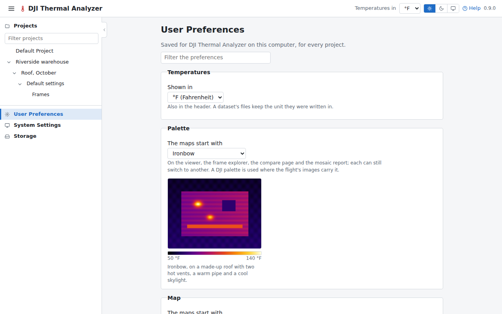
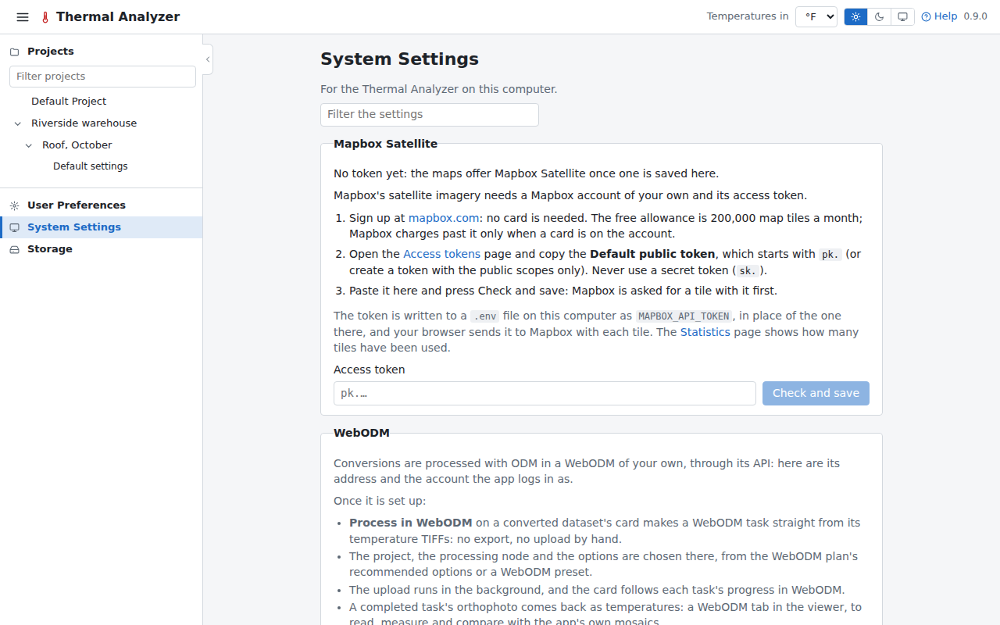

# Preferences and settings

Both pages are in the navigation pane, with [Storage](storage.md). Each has a filter at the top, showing the sections
whose title, labels, help or choices have the words typed ("dark" finds Theme).

## User Preferences

In the order the page has them:

- **Temperatures:** the unit, °F, °C or K. Also in the header.
- **Palette:** the palette the map pages start with: each flight's images' own, or one chosen. The viewer, the frames
  explorer, the compare page and the mosaic report open with it, and can still switch. A small made-up roof beside it
  shows the palette chosen.
- **Map:** the map every map starts with: ESRI Satellite, OpenStreetMap, Mapbox Satellite once it has a token, or
  none. Each map can still switch, and a Mapbox that refuses its token goes back to ESRI Satellite. See
  [The maps under the mosaics](maps.md).
- **Theme:** light or dark pages, or the computer's own. Also in the header.
- **Dates and times:** the locale they are written in: the computer's, or one chosen.

A flight's capture times are shown in the time where it was flown, labelled with its time zone (for example UTC−5),
found from the frames' two clocks. A flight analyzed by an earlier version of the app is analyzed again for it.

## System Settings

- **Mapbox Satellite:** the Mapbox token (see [The maps under the mosaics](maps.md#mapbox-satellite)).
- **WebODM:** its address and login, or an account created there with a WebODM admin's login, with a short list of
  what connecting it brings (see
  [WebODM](webodm.md#connecting-it)).
- A link to [Storage](storage.md).
