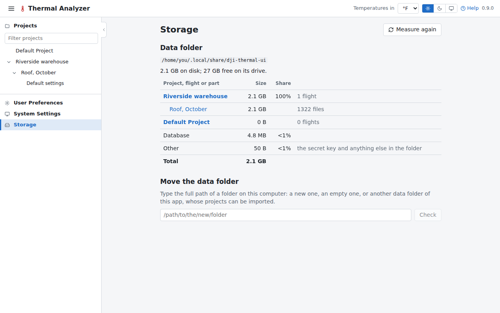

# Storage

The Storage page, in the navigation pane beside the other settings pages, shows where the
[data folder](../reference/data.md) is, its size on disk as measured when the page opens (and again on asking) and
the free space on its drive, with each project and its flights, the database and the rest. A flight read in place
from a folder says how much its images take there, outside the data folder's total.

## Moving the data folder

The data folder can be moved from this page to another folder:

1. **Type the new folder's full path and check it.** It may be a new folder, an empty one, or another data folder of
   this app. A folder holding other files is refused, as is one without room (on another drive, the whole data folder
   is copied there, then removed here). Nothing moves while a job runs or a project is being imported.
2. **Moving restarts the server.** The database cannot change under a running server, so the server stops, moves the
   files as they are (same ids and links; a flight read in place is still read there) before it opens the database
   again, and starts again on the same port. The page reloads when it is back and says how the move went.

**Another data folder there** offers its projects, all chosen at first. Its database and files are set aside in
`replaced-<date>/` in it, nothing deleted; the projects chosen are then imported from them as an export would bring
them (new ids, and a name already used gets a number), their files moved out of the folder set aside. A folder set
aside stays in the data folder, counted under Other, and moves with it.

**The new folder is remembered** in a `data-dir` file in the app's config folder (see
[Where the data lives](../reference/data.md#the-config-folder)). `--data-dir` and `DJI_THERMAL_UI_DATA_DIR` still win,
and a folder they set is not moved from the page. When the folder moved to is missing (a drive not connected), the
app says so and stops rather than starting with an empty one.
