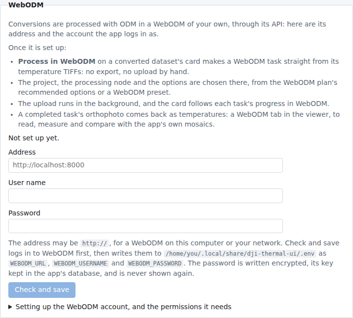

# WebODM

Processing with ODM is done in a WebODM of your own, through its API: DJI Thermal Analyzer sends a dataset's temperature
TIFFs to it as a task, follows it, and can bring its orthophoto and surface model back. The flight page's
**WebODM plan** tab says how the flight would be processed there.

## Connecting it

The app logs in to WebODM as a WebODM account. Under System Settings › WebODM, give its address (`http://` is fine,
for a WebODM on this computer or your network), the account's user name and its password, and press
**Check and save**. The app logs in to WebODM first and saves them
only if WebODM takes them; it then lists the processing nodes the account can see. Otherwise it says why (a wrong
login, WebODM out of reach, an address that isn't WebODM's) and nothing is changed.

### Where the login is kept

The address, user name and password are kept as `WEBODM_URL`, `WEBODM_USERNAME` and `WEBODM_PASSWORD` in a `.env`
file, as the [Mapbox token](maps.md#where-it-is-kept) is (the one they were read from, else the data folder's, made readable by you only), never in the database. The password is
written encrypted (`WEBODM_PASSWORD=enc:…`, AES with a fresh random IV each time, so saving the same password twice
gives two different values), with a key the app makes once and keeps in its database, not in `.env`: the file alone
doesn't give the password away. A password typed into the file by hand is encrypted in place the next time the app
starts; one set in the environment is left as it is. If the key is gone (the data folder's database replaced, or
`.env` used with another data folder), System Settings › WebODM says the saved password can't be read: type it
again. The page never shows the password, only that one is set, and shows the user name masked; leave either empty
to keep the saved one. Remove takes all three out of the file, and the key out of the database. Set in the environment the app is started from, they win over the files:
System Settings then shows them, and they are changed there. The app asks WebODM for a login token when it needs one
and keeps it in memory only.

### Creating the account from here

With a WebODM admin's login at hand, System Settings › WebODM can create the account itself: press
**Create the account…**, then type WebODM's address, the admin's user name and password, the new account's user name
(`dji-thermal-ui-api-user` unless you change it) and its password, or press **Generate** for a long random one, shown
so you can note it. **Create and save** logs in to WebODM as the admin, creates an ordinary account (not staff),
logs in as it and saves it as **Check and save** does, listing the processing nodes it sees. WebODM puts a new
account in its **Default** group, which gives it the permissions below (steps 1 and 2). The admin's login is used
for that one request: it is never saved, and its token is forgotten at once. A saved login is replaced only after you
confirm.

Nothing is changed in WebODM when it says no:

- **The admin's login is refused**, or **the admin is not staff**: use an account with **Staff status**.
- **A user name WebODM already has:** choose another, or, to use that account, type its password in the login form.
  The app never changes an existing WebODM account.
- **A WebODM without the API for adding users:** set the account up by hand, as below.

If the new account sees no processing node, WebODM's processing node was added after it first started: give the
account **Can view Processing Node** on it (step 3 below).

### The account

The account is set up by a WebODM admin, in WebODM's Administration (its `/admin/` pages), unless it was
[created from here](#creating-the-account-from-here). System Settings › WebODM walks through it with the names those
pages show, linking to them once WebODM's address is saved:

1. **Users › Add user**: a user name and a password. Leave **Active** ticked, **Staff status** and **Superuser status**
   unticked: an ordinary account is enough.
2. **Its permissions.** A new account is in WebODM's **Default** group, which holds these unless they were taken away
   from it (Groups › Default); else add them to the account under **User permissions**:
   - `app | Project | Can add Project` (`app.add_project`): to create projects. The account owns those it creates,
     with every permission on them.
   - `app | Task | Can add Task`, `Can change Task` and `Can delete Task` (`app.add_task`, `app.change_task`,
     `app.delete_task`): to create, upload to, follow, cancel and remove tasks.
   - `app | Preset | Can add Preset`, `Can change Preset` and `Can delete Preset` (`app.add_preset`,
     `app.change_preset`, `app.delete_preset`): to keep task options as presets.
   - `nodeodm | Processing Node | Can view Processing Node` (`nodeodm.view_processingnode`).
3. **Each processing node** the account may use: Processing nodes › the node › **Object permissions**, type the user
   name in User identification, Manage user, choose **Can view Processing Node** and save (or the same for the
   Default group, under Groups). WebODM gives it to the Default group only for the node there when it first
   started: a node added later is not offered to the account until it, or its group, is given it.
4. **Only for a project the account didn't create:** Projects › the project › Object permissions: Can view Project to
   see it, Can change Project to add tasks to it and Can delete Project to remove its tasks. A project shared with
   the account is never deleted through the API.
5. Back in System Settings › WebODM, **Check and save**: the processing nodes the account sees are listed, and none
   means step 3 is missing.

## Processing a dataset

Once a dataset is converted with temperature TIFFs (`temp_c:tiff`), **Process in WebODM** in its card's menu makes a
WebODM task from them:

- **The checks:** a dataset still converting, one whose frames had their location removed, or one without at least
  two temperature TIFFs can't be sent. Settings that differ from the WebODM plan's (normalization, the pitch limit,
  the emissivity or humidity) are said, and can still be sent.
- **The project:** a new WebODM project, named after the app's project unless you change it, or one of the
  account's, searched by name (one of the app's project's name is chosen when there is one). Nothing is remembered.
- **The options:** the WebODM plan's, the recommended ones ticked and those to consider not, with the plan's reason
  for each; **Add an option** offers any other the processing nodes offer, with an input for its type. A WebODM
  preset (the account's or WebODM's own) can be applied: its options are ticked with its values, the others left
  as they are. The ticked options can be kept as a preset of the account's own (the same name changes it). The
  preset last applied is offered first next time.
- **The processing node** (or WebODM's choice) and the task's name, "flight - dataset" unless changed.
- **Make a DSM:** asks WebODM for a surface model as well (`dsm`, and `fast-orthophoto` left out, as it makes none),
  for the mosaics to be projected onto (below). The task takes longer.

**Upload to WebODM** sends the TIFFs in the background, beside conversions, so a long upload holds nothing up: the
task is made waiting for its images, the TIFFs sent in batches, then the task committed and processed. An upload
can be canceled; one canceled, refused or cut short by the app stopping removes the half-made task from WebODM (and
the project, when it made it), at the next start if WebODM couldn't be reached.

The card lists the tasks made from the dataset, each with a link to it in WebODM and its progress: the upload's,
then WebODM's while it is queued or processing (asked at most every 5 seconds while the page shows it). A task can
be taken off the list; deleting the dataset does the same. Neither removes it from WebODM.

## Bringing the results here

Once WebODM has completed a task, **Bring the orthophoto here** on its line downloads its orthophoto in the
background (with its progress, and a cancel). It is kept as temperatures, in the dataset's unit, and shown on the
dataset's viewer as a **WebODM** tab beside its mosaics (even without mosaics of its own): coloured, read under the
pointer, measured and saved as findings as they are, and offered on the compare page, beside the app's own mosaics
or as their difference. ODM blends the frames, so it doesn't say which frames a spot came from. The orthophoto has
to hold temperatures, which the WebODM plan's `radiometric-calibration none` keeps; one of colours is refused. A
dataset shows one orthophoto: another task's replaces it. The card says which task it came from and can remove it;
taking that task off the list removes it too. WebODM keeps its own copy either way.

A completed task that was asked for a DSM also has **Bring the DSM here** (one download per task at a time). The DSM
is kept as WebODM wrote it, once dji-thermal-cli has read it, and the card says it is there:

- **Project the mosaics onto it:** ticked when it arrives. The next time the mosaics are built, the frames are
  projected onto WebODM's surface instead of the heights dji-thermal-cli estimates from the frames themselves, so
  roofs and walls line up better at the seams. The mosaic's report says the heights came from the DSM.
- **The height cell:** the size of the cells the surface is read on, in mosaic pixels (8 to 1024; 16 at first),
  with its size on the ground once the mosaics are built (16 px was about 24 cm in a test flight, and gave straight
  roof edges where the default 64 px stepped).
- **Build the mosaics again** shows when the mosaics were built otherwise (without it, or on another cell).

A dataset keeps one DSM: another task's replaces it, keeping the tick and the cell. **Remove**, or taking its task
off the list, removes it; the mosaics built on it are kept.

The DSM is also shown on the viewer, on a **Heights** tab: the height of the ground, roofs and trees in metres above
the DSM's lowest ground (its 1st percentile, so a stray low pixel doesn't set it), with the palette (Viridis at first)
and range as the View angle tab has them. On every tab, Pointer info gives the **Ground height** under the cursor (its
tooltip, the height as WebODM gives it), and a spot measured on a temperature tab gets its ground height, an area its
lowest, mean and highest.
