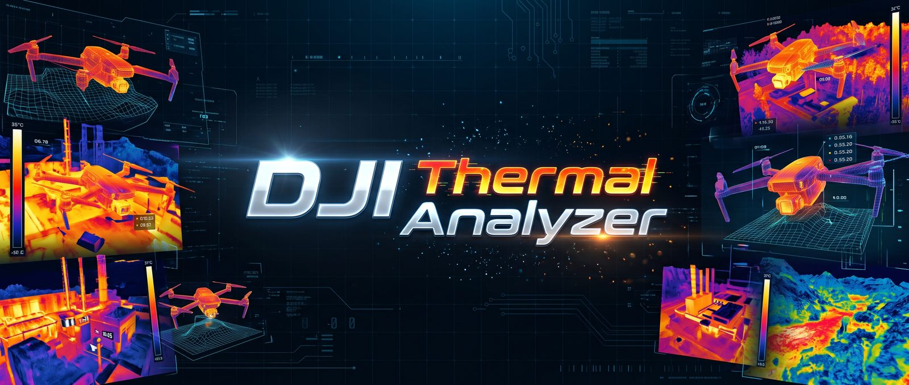

# DJI Thermal Analyzer

DJI Thermal Analyzer (the `dji-thermal-ui` command) analyzes, converts, mosaics and measures DJI thermal flights in the
browser, on your own computer. It does the work with [dji-thermal-cli](https://github.com/WinuxNomacs/dji-thermal-cli),
so neither ODM nor the DJI Thermal SDK is needed. Its [mosaics](guide/mosaics.md) are a preview to help the analysis,
not a replacement for an orthomosaic made by photogrammetry, such as ODM's or WebODM's.

It runs on Linux, macOS and Windows. The server listens on 127.0.0.1 only, for the one person using the computer:
there are no logins or accounts.

- **[Getting started](getting-started/install.md):** install it, run it, and find your way around its pages.
- **[Quickstart](quickstart/index.md):** short tutorials, from a first flight to its report.
- **[User guide](guide/projects.md):** a page for each part of the app, named as the app names it.
- **[Reference](reference/command.md):** the command, and where the data lives.
