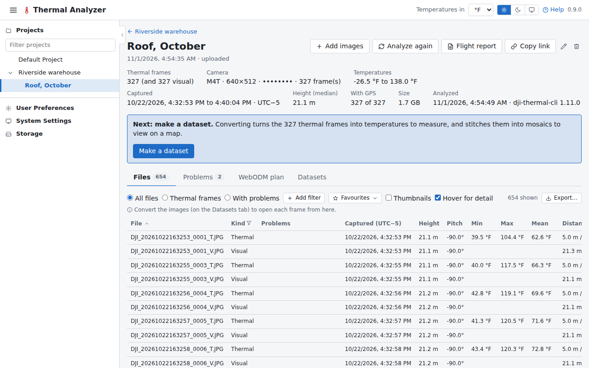
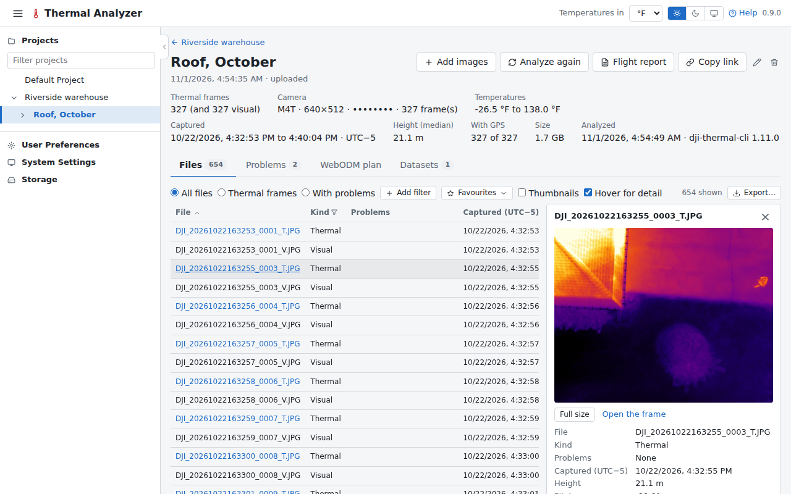
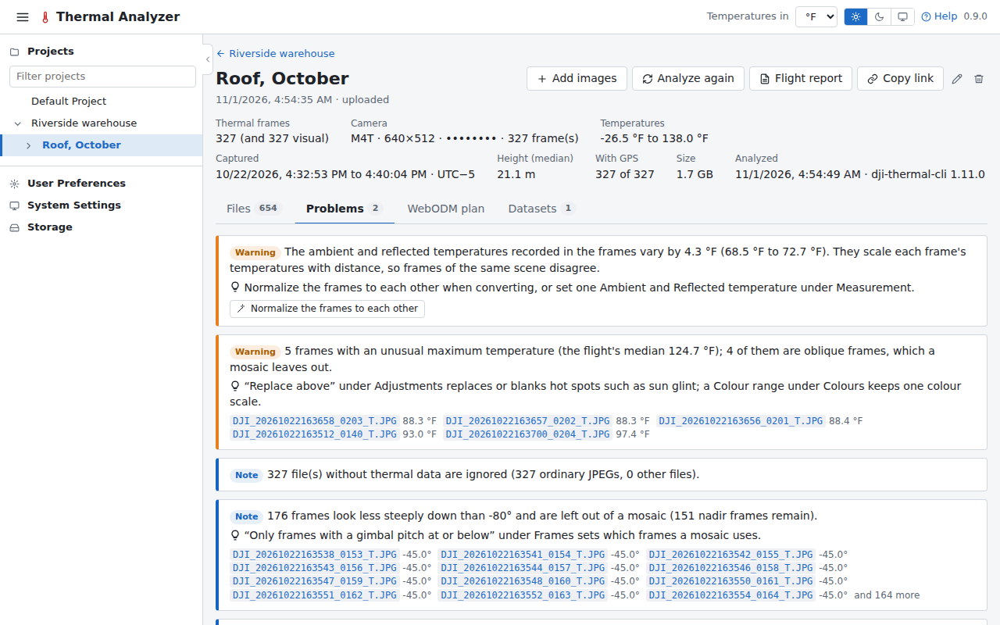

# Read the analysis

Once dji-thermal-cli has read the images, the flight's page shows what it found: the flight's figures at the top,
then its tabs.

## 1. The figures

At the top: how many thermal frames there are (and visual images beside them), the camera, the range of the
temperatures, when the flight was captured (in the time where it was flown), the median height, how many frames have
a position, and the size on disk. A box under them says what comes next: making a dataset, in the
[next tutorial](mosaic.md).

## 2. The files

The **Files** tab lists every file, with its kind, capture time, height, pitch and temperatures. Pass the pointer over
a file's name: a pane at the right shows its picture and its columns. Click a row to keep it there, and **Full size**
to see the picture at its own size.

**Thermal frames** and **With problems** filter the list; **Add filter** filters on any column, such as the height or
the temperatures. See [Files](../guide/flights.md#files) for all it can do.

## 3. The problems

The **Problems** tab lists what dji-thermal-cli found that could spoil the temperatures or the mosaics, such as frames
much hotter than the rest or taken at an angle, with the files concerned. A problem a setting fixes has a button that
puts that setting in the New dataset form.

Next: [convert and open the mosaic](mosaic.md).
