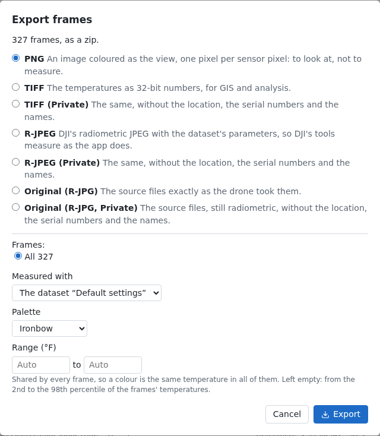
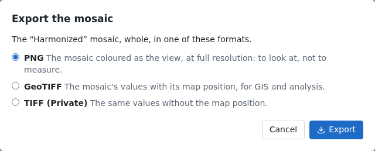

# Export

**Export…** saves frames or a mosaic in the format that suits what comes next.

## 1. Frames

On the flight's **Files** tab, **Export…** exports the frames the filter shows (all of them, unfiltered). Choose the
format: PNG to look at, TIFF for the temperatures, R-JPEG for DJI's tools, or the files as the drone took them. The
Private ones leave out the location, the serial numbers and the names. Then the dataset that measures them, and the
palette and range of a PNG.

Press **Export**: several files come as a zip, made as it downloads.

## 2. A mosaic

In the viewer, **Export…** exports the mosaic tab shown, whole, at full resolution: as its GeoTIFF (private or not),
or as a PNG.

See [Exports](../guide/exports.md) for each format and when one is turned off.
