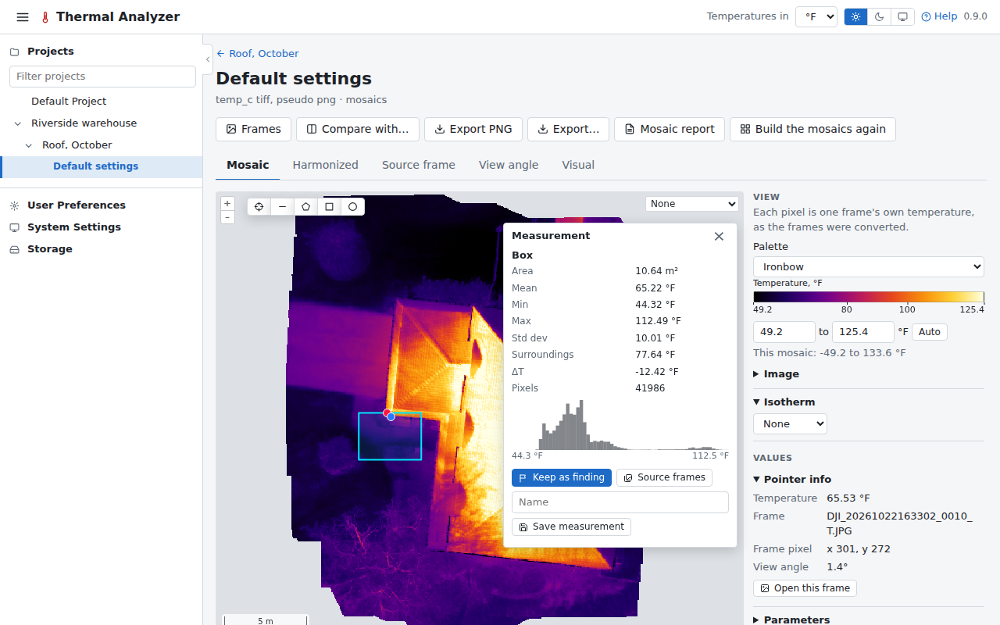
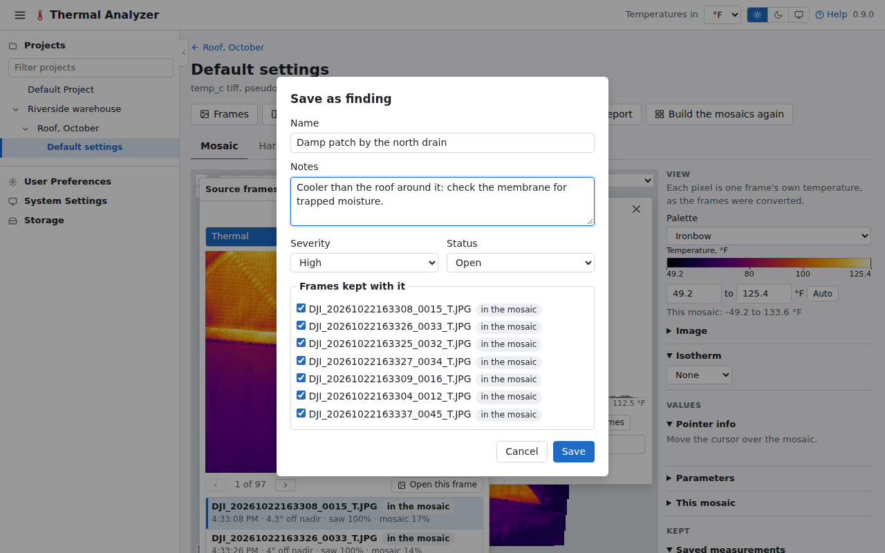
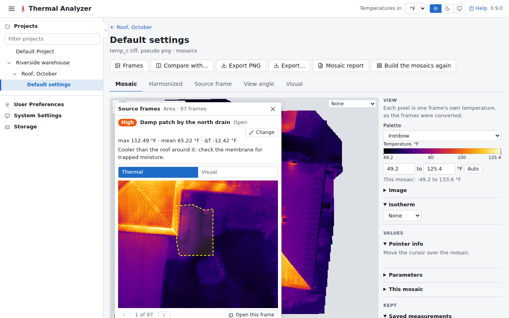

# Measure and keep a finding

A finding is a spot or an area kept on the flight with a name, notes, a severity and the frames that saw it: what a
report is made of.

## 1. Measure

The drawing tools are on the map's top edge: a spot, a line, an area, a box and a circle. Choose the box and drag it
across the place to measure. A card on the map gives its temperatures, the ΔT against its surroundings, and a
histogram.

**Save measurement** keeps it as a measurement, listed in the panel under Kept. Here, keep it as a finding instead.

## 2. Keep it as a finding

Press **Keep as finding** on the card. The form opens over the frames that saw the area: give it a name, notes, a
severity and a status, and choose the frames to keep with it.

Press **Save**. The finding is drawn on the map in its severity's colour, and opens with its frames when clicked.

See [Findings](../guide/findings.md) and [Measuring](../guide/measuring.md).

Next: [print the reports](report.md).
