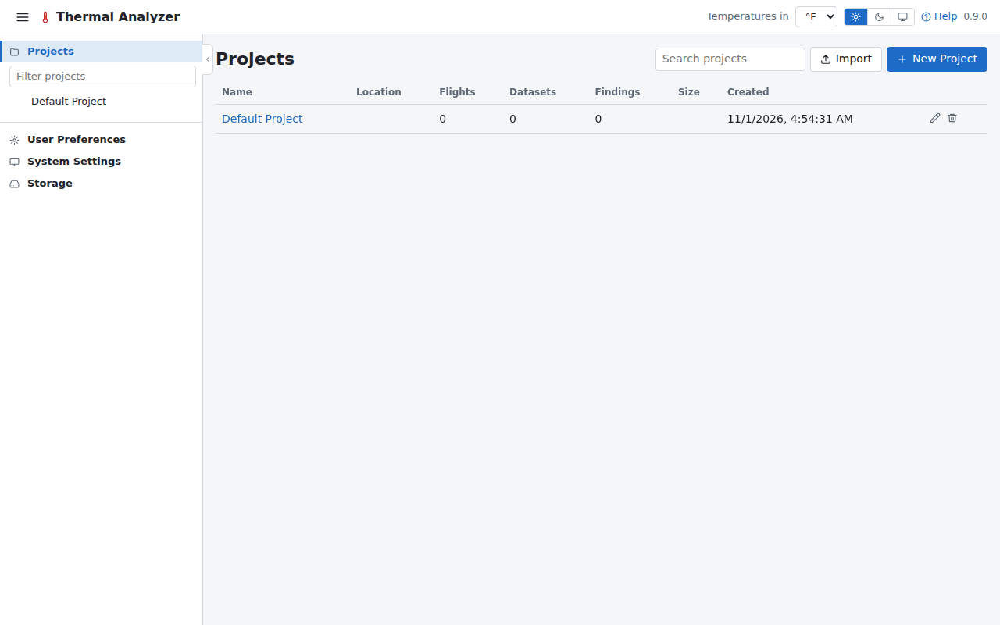
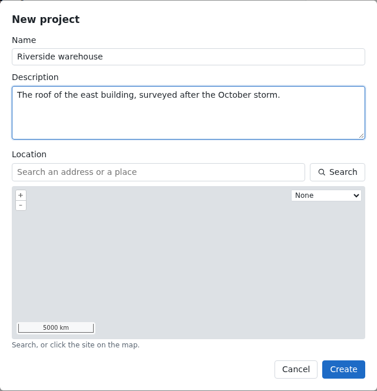
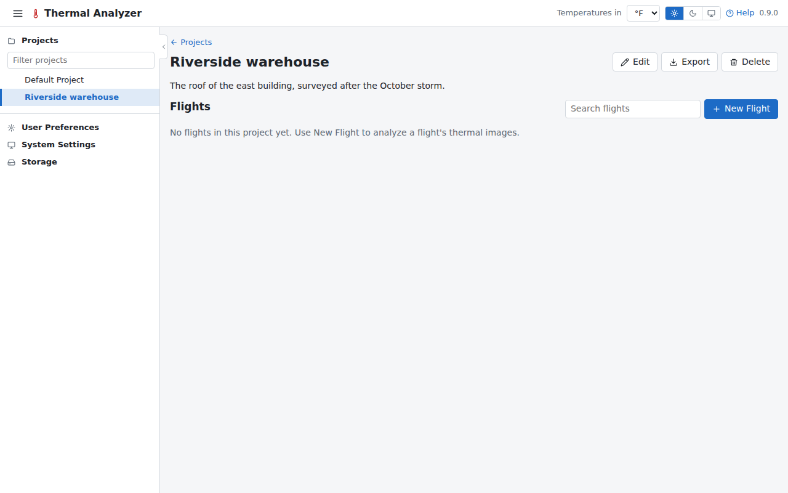
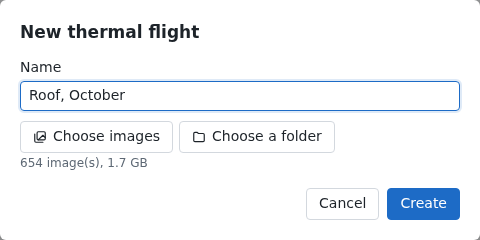
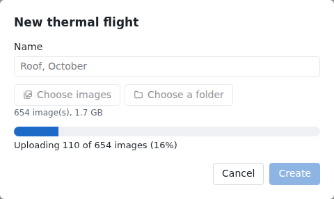
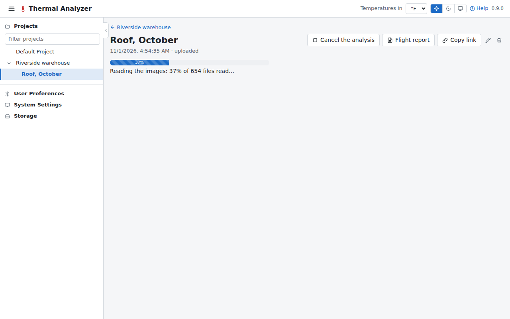

# Make a project and a flight

A project holds a site's flights; a flight holds the images of one flight of the drone. This tutorial makes both and
uploads the images, which dji-thermal-cli then analyzes.

## 1. Make a project

On the projects page (the app opens on it), press **New Project** at its top right.

Then give it a name and, if you like, a description.
Its location is optional: search an address or click the site on the map, or leave it for later.

Press **Create**. The project's page opens, with no flights yet.

## 2. Make a flight

Press **New Flight**, name the flight, then choose its images: **Choose images** for files picked one by one, or
**Choose a folder** for a whole folder. Choose the thermal R-JPEGs, and the visual images (`_V` or `_W`) and videos
the drone took with them if you have them: other files are left out. The dialog counts the images chosen.

Press **Create**. The images are uploaded, with their progress.

## 3. Wait for the analysis

When the images are in, the flight's page opens and dji-thermal-cli reads them.

Next: [read the analysis](analysis.md).
