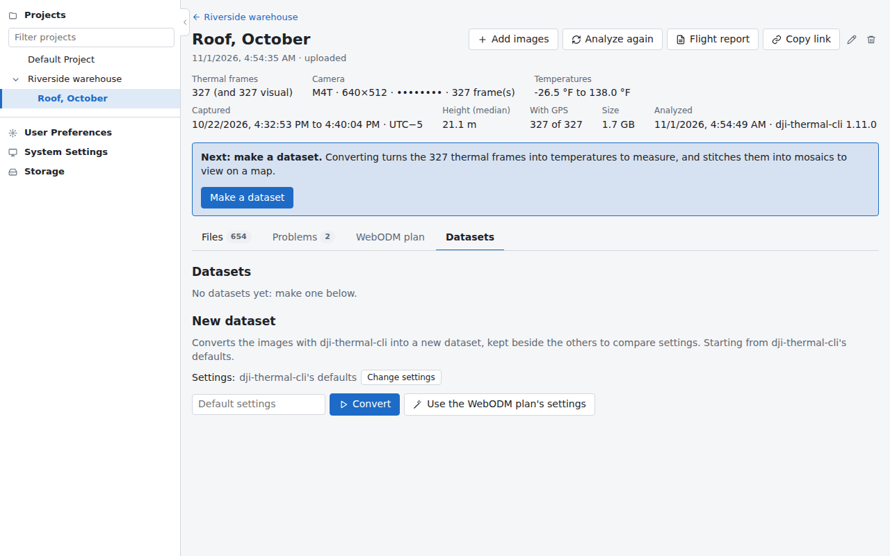
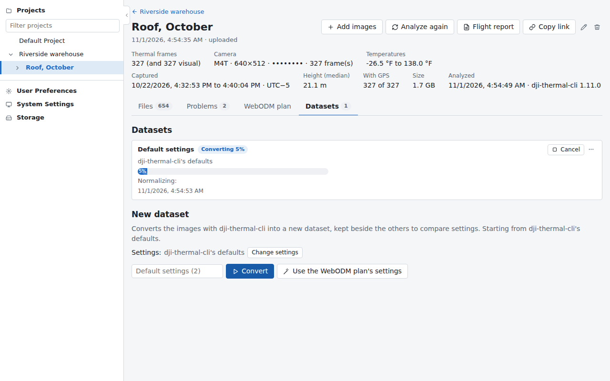
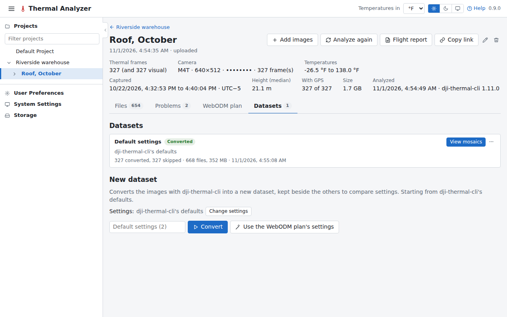
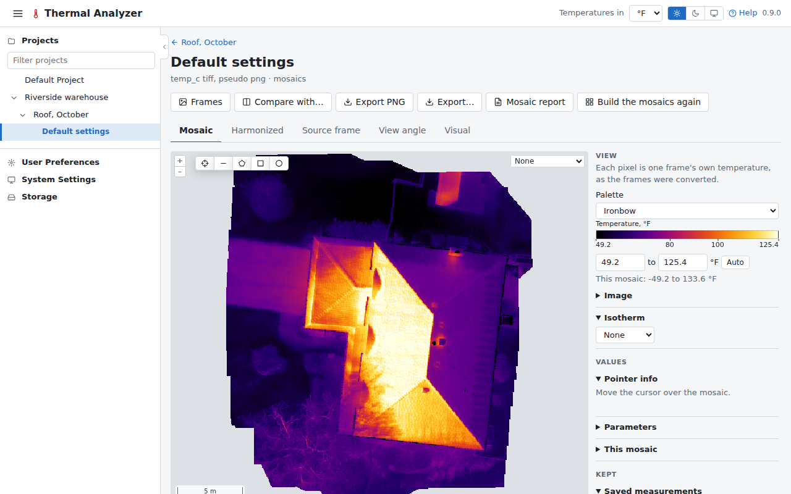

# Convert and open the mosaic

A dataset is the flight's images converted to temperatures, with mosaics stitched from them. A flight can have
several, made with different settings.

## 1. Make a dataset

Press **Make a dataset** in the box above the tabs, or open the **Datasets** tab. The New dataset form starts from
dji-thermal-cli's defaults, which suit most flights; **Change settings** shows them all. Leave the name empty to have
the dataset named after its settings.

Press **Convert**. The dataset's card shows its progress: converting the frames, then building the mosaics. It can be
cancelled.

## 2. Open the mosaic

When it is done, the card's button is **View mosaics**.

It opens the viewer, on the mosaic of temperatures. The tabs above the map show the same place in other ways
(**Harmonized** evens out the frames' differences); the panel at the right sets the palette and the range, and
**Pointer info** gives the temperature under the cursor.

See [Mosaics](../guide/mosaics.md) for each tab and the panel's sections.

Next: [measure and keep a finding](finding.md).
