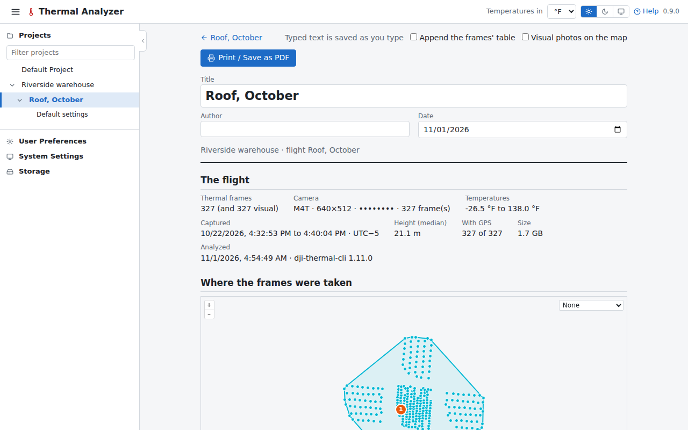
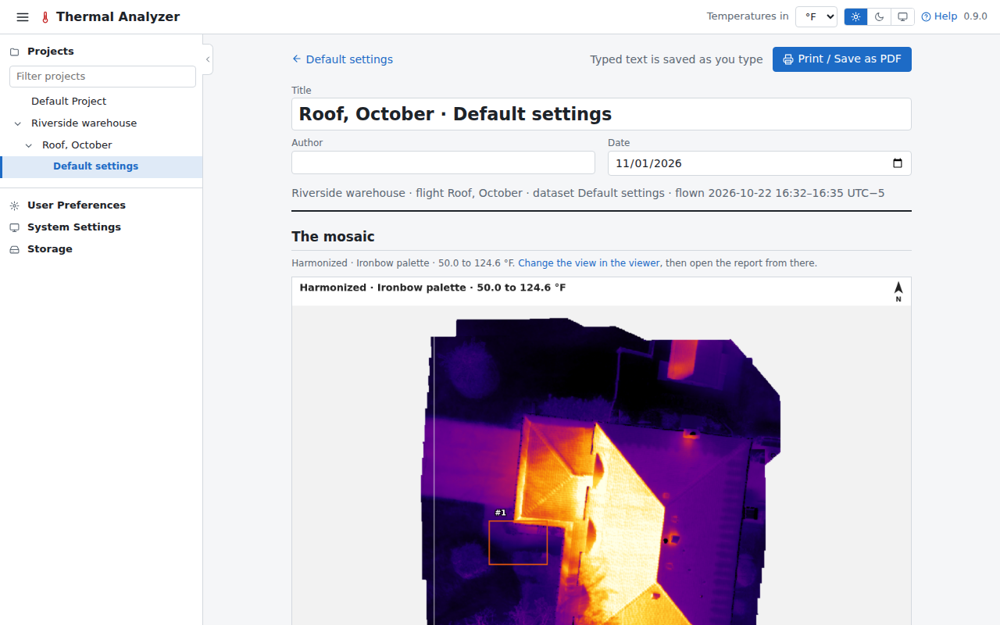

# Print the reports

Two reports are laid out to print, or to save as PDF from the browser's print dialog.

## 1. The flight report

Press **Flight report** on the flight's page. It holds the flight's figures, a map of where the frames were taken with
the findings numbered, the problems, the datasets, and the findings with their frames. Type a title, the author and
notes on the page: they are saved as you type.

Press **Print / Save as PDF**, and choose the paper size, or Save as PDF as the printer. The report always prints
light, without the app's header and controls.

## 2. The mosaic report

In the viewer, set the mosaic as you want it shown (the tab, the palette, the range), then press **Mosaic report**. It
shows the mosaic as the viewer did, with the measurements and findings numbered, the colour scale, a scale bar and
north, then each measurement and finding in detail.

See [Reports](../guide/reports.md).

Next: [export](export.md).
